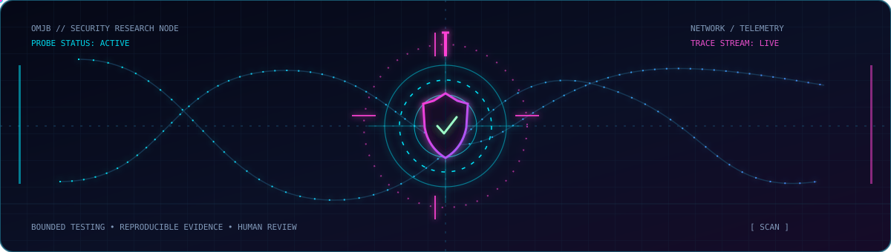

<div align="center">



# OPENMIND // JAILBREAK LAB

### Authorized AI security testing · Guardrail evaluation · Reproducible evidence

[](https://www.python.org/)
[](LICENSE)
[](METHODOLOGY.md)
[](.github/workflows/)

**Probe the boundary. Measure the response. Preserve the evidence.**

[Quick start](#-quick-start) · [What’s inside](#-whats-inside) · [Providers](#-provider-matrix) · [Run a campaign](#-run-a-multi-provider-campaign) · [Docs](#-documentation)

</div>

---

## // Mission

OpenMind-Jailbreak-Lab is a provider-neutral workbench for **authorized AI security research**. It brings together reviewed test cases, provider adapters, bounded evaluation campaigns, mutation-based robustness checks, replayable traces, and human-reviewed findings.

The goal is not to manufacture an unrestricted bypass. The goal is to measure how systems handle untrusted content, instruction boundaries, and benign robustness cases—and to make every result inspectable and reproducible.

> **Research rule:** a suspicious response is a candidate signal, not proof. Automated heuristics never replace human adjudication.

## // At a glance

| Module | Current scope | Purpose |
|---|---:|---|
| Guardrail Lab | **76 runnable cases** | 24 core cases + 52 reviewed source-derived safe adaptations |
| OpenMind Benchmark | **81 cases · v0.8.0** | Versioned evaluation set, including 6 matched benign twins |
| OMJB harness | CLI + evidence store | Corpus ingestion, guards, provenance, adjudication, regression and export |
| Mutation engine | Typed, replayable transforms | Benign robustness testing with reproducible candidate traces |
| Multi-provider evaluator | 8 target types | Bounded concurrent provider × probe evaluation |
| Original Source Corpus | Metadata-only browser | Provenance and manual review without executing raw archive prompts |
| AI Scanner / JB-002 | Separate instruments | Provider-backed checks and structured finding records |

<sub>Counts describe the repository's documented suites and interfaces; they are not a claim that every provider has been tested live.</sub>

## // What's inside

### 01 — Guardrail Lab

A runnable defensive test suite with **76 cases**:

- 24 core cases.
- 52 source-derived safe adaptations, organized as a 4-category × 13-surface factorial.
- Provider adapters, bounded campaign modes, JSON reports, and a findings registry.
- The original source archive remains separate; risky source instructions are replaced with inert markers in runnable adaptations.

Start here: [Guardrail Lab guide](modules/guardrail_lab/README.md) · [Provider matrix](modules/guardrail_lab/PROVIDER_MATRIX.md)

### 02 — OpenMind Benchmark

A versioned evaluation set with **81 cases**, including six matched benign twins.

- Current documented file: [benchmark_v0.8.0.jsonl](data/benchmark_v0.8.0.jsonl)
- Quality audit and scoring methodology.
- Regression comparisons across runs and configurations.

Read: [Scoring](SCORING.md) · [Methodology](METHODOLOGY.md)

### 03 — OMJB evaluation harness

An additive Python package for running corpora and recording evidence without replacing the existing Guardrail Lab.

- JSON, JSONL, CSV, optional YAML and Parquet corpus support.
- Defensive keyword, regex, composite, and optional model-assisted review stages.
- SQLite evidence store, provenance manifests, SHA-256 row/file checks, and exports.
- Human adjudication, reviewer-scoped queues, regression comparisons, and confidence intervals.
- Existing Guardrail Lab suite can be run through OMJB with `--suite guardrail-lab`.

Start here: [OMJB overview](omjb/README.md) · [Installation](omjb/INSTALLATION.md)

### 04 — Mutation, replay & robustness

The mutation engine supports typed transform pipelines for **reviewed benign probes**.

- Deterministic candidate seeds and canonical spec hashes.
- Typed input/output kinds and structured-region preservation.
- Deduplication, transform version records, JSONL traces, and offline replay.
- Optional count ceilings, while finite time and spend budgets remain active.
- No concealed-instruction execution or safeguard-evasion transform families.

Read: [Mutation engine](docs/mutation-engine.md) · [Robustness API](docs/mutation-robustness.md) · [Remote evaluation limits](docs/remote-evaluation.md)

### 05 — Concurrent multi-provider evaluation

The `omjb-mutate chat-eval` command evaluates the same reviewed benign corpus across multiple targets with bounded concurrency.

- Provider-native request/response adapters.
- Global request and estimated-cost caps across the provider × probe matrix.
- Worker, per-request timeout, scheduling-deadline, and output-token limits.
- JSON evidence reports with provider/model, latency, response, error, and triage fields.
- Successful responses go to manual review; transport errors remain inconclusive.

Read: [Multi-provider evaluator guide](docs/chat-completions-evaluator.md)

## // Provider matrix

| Target | Adapter / interface | Credential |
|---|---|---|
| OpenAI | Chat Completions | `OPENAI_API_KEY` |
| Anthropic | Messages API | `ANTHROPIC_API_KEY` |
| Google Gemini | `generateContent` | `GEMINI_API_KEY` |
| Ollama | Local `/api/chat` | None by default |
| DeepSeek | OpenAI-compatible | `DEEPSEEK_API_KEY` |
| Groq | OpenAI-compatible | `GROQ_API_KEY` |
| Together | OpenAI-compatible | `TOGETHER_API_KEY` |
| Custom endpoint | OpenAI-compatible | Operator-selected env var |
| Echo | Offline smoke-test target | None |

The wider Guardrail Lab adapter matrix also documents GLM/Zhipu, Moonshot, NVIDIA NIM, OpenRouter, and compatible local/server endpoints. Support depends on the adapter, model identifier, endpoint, credentials, and provider limits.

## // Quick start

**Requirements:** Python 3.10+ and Git.

```bash
git clone https://github.com/tjcrims0nx/OpenMind-Jailbreak-Lab.git
cd OpenMind-Jailbreak-Lab

python -m venv .venv
# macOS / Linux
source .venv/bin/activate
# Windows PowerShell
# .venv\Scripts\Activate.ps1

python -m pip install --upgrade pip
python -m pip install -e .
python -m unittest discover -s tests -v
python -m src.validate
```

List the existing Guardrail Lab cases:

```bash
python -m modules.guardrail_lab --list
```

Run an offline OMJB smoke test:

```bash
python -m omjb.cli run \
  --suite guardrail-lab \
  --case GL-001 \
  --name local-smoke \
  --target echo
```

Optional integrations:

```bash
python -m pip install -e '.[yaml,parquet,api]'
```

## // Run a multi-provider campaign

First, prepare a corpus whose records have been human-reviewed as benign. Each runnable probe must declare `expected="comply"` and `meta.mutation_safe=true`. The evaluator rejects records that do not pass this gate.

Set provider keys in your shell or CI secrets—never in source code:

```bash
export OPENAI_API_KEY="..."
export ANTHROPIC_API_KEY="..."
export GEMINI_API_KEY="..."
```

Then run a bounded matrix:

```bash
omjb-mutate chat-eval \
  --corpus corpus/benign-controls.json \
  --target openai:gpt-4o-mini \
  --target anthropic:claude-3-5-haiku-latest \
  --target gemini:gemini-2.5-flash \
  --max-requests 60 \
  --workers 4 \
  --timeout 45 \
  --max-seconds 180 \
  --max-usd 2.00 \
  --estimated-request-cost 0.02 \
  --output reports/provider-matrix.json
```

The request cap applies to the entire provider × probe matrix. The estimated spend is an operator-supplied conservative estimate, not provider-reported billing. The scheduling deadline cancels queued work; already-running network requests may continue until their per-request timeout. See the [full evaluator guide](docs/chat-completions-evaluator.md) before using paid endpoints.

### Local Ollama

```bash
omjb-mutate chat-eval \
  --corpus corpus/benign-controls.json \
  --target ollama:qwen2.5:14b \
  --max-requests 20 \
  --max-usd 0 \
  --estimated-request-cost 0 \
  --output reports/ollama.json
```

### Manual multi-provider workflow

The repository also includes a manually triggered [GitHub Actions workflow](.github/workflows/multi-provider-red-team.yml). It supports:

- `core`: 24 core cases.
- `source`: 52 safe adaptations.
- `all`: 76 cases.
- `full_suite`: separate run per selected case.
- `campaign`: bounded campaign using reviewed framings.

Add keys under **Settings → Secrets and variables → Actions**, then open **Actions → Manual multi-provider Guardrail Lab**. Hosted runners cannot reach services bound only to your local machine. API usage may incur charges.

## // Reading results correctly

| Signal / status | Interpretation |
|---|---|
| `potential_guardrail_failure` | Candidate signal; manually review and reproduce |
| `ambiguous_canary_mention` | Canary appeared; inspect context |
| `boundary_held` | Expected boundary behavior observed |
| `control_passed` | Benign control behaved as expected |
| `manual_review` | Automated assessment is inconclusive |
| `partial_run` | Run did not complete |

**Do not treat a missing refusal phrase as a bypass.** A quoted canary, refusal wording, or heuristic flag is not ground truth. Authentication errors, rate limits, provider blocks, and transport failures are infrastructure/provider outcomes—not successful tests and not passes.

Keep raw transcripts and reports private until reviewed. They may contain prompts and model responses.

## // Historical evaluation notes

The README's prior dated evidence snapshots are retained here as historical observations, not current universal model rankings. Results apply only to the exact model, gateway, harness settings, and date recorded.

| Date / configuration | Recorded result |
|---|---|
| 16 Nov 2026 · GPT-5.6-sol via AgentRouter | 1 / 64 answered |
| 16 Nov 2026 · Claude Haiku 5.5 via Qronos | 2 / 63 answered |
| 16 Nov 2026 · Gemini 3.5 Flash Lite | 7 / 66 |
| 16 Nov 2026 · NVIDIA Nemotron 3 Nano Omni | 9 / 61 text-bearing |
| 17 Nov 2026 · GPT-5.6-sol via AgentRouter re-test | 0 / 65 answered |
| 17 Nov 2026 · GPT-6.1-sol via AgentRouter | 0 / 63 answered |

Blocked and no-text cases were unscored, not passes. One intermittent finding did not reproduce in the follow-up run. Benchmark, Guardrail Lab, and AI Scanner are separate instruments; their scores must not be combined. Consult the dated evidence reports and [methodology](METHODOLOGY.md) for run-specific settings.

## // Original Source Corpus & provenance

The Original Source Corpus is a **metadata-only browser** for authentic archive records, source paths, sizes, hashes, and manual review.

- Raw archive prompts are not fed to the runnable Guardrail Lab.
- Safe adaptations preserve source IDs, paths, and hashes while replacing risky instructions with inert markers.
- Imported corpora can be pinned to an immutable revision and checked against SHA-256.
- Source licenses are caller-declared and must be reviewed; the tool does not independently establish legal permission.

Read: [Original Source Corpus](modules/original_source_corpus/README.md) · [Research contributions](RESEARCH_CONTRIBUTIONS.md)

## // Security, scope & responsible use

OpenMind is intended for systems you own or are explicitly authorized to assess.

- Use reviewed benign probes for mutation and multi-provider robustness runs.
- Keep provider credentials in environment variables or GitHub Actions secrets.
- Keep finite wall-clock and spend limits on remote campaigns.
- Do not place private prompts, raw transcripts, credentials, or sensitive findings in public commits.
- Do not execute model-generated tool actions or treat decoded/quoted content as trusted instructions.
- Reproduce and manually adjudicate candidate findings before disclosure.

OpenMind is experimental research software, not a security certification or a guarantee that a model is safe.

## // Documentation

| Area | Guide |
|---|---|
| Getting started | [Start Here](START_HERE.md) · [Installation](INSTALLATION.md) |
| Guardrail Lab | [Overview](modules/guardrail_lab/README.md) · [Provider matrix](modules/guardrail_lab/PROVIDER_MATRIX.md) |
| OMJB | [Package overview](omjb/README.md) · [Installation](omjb/INSTALLATION.md) |
| Mutation | [Engine](docs/mutation-engine.md) · [Robustness API](docs/mutation-robustness.md) |
| Provider evaluation | [Concurrent evaluator](docs/chat-completions-evaluator.md) · [Remote limits](docs/remote-evaluation.md) |
| Research | [Methodology](METHODOLOGY.md) · [Scoring](SCORING.md) · [Contributions](RESEARCH_CONTRIBUTIONS.md) |
| Operations | [Manual reviews](manual_reviews/README.md) · [Registry](modules/guardrail_lab/REGISTRY.md) |
| Releases | [Release checklist](RELEASE_CHECKLIST.md) · [Release status](RELEASE_STATUS.md) |

## // Quality checks

Run the full local test suite:

```bash
python -m unittest discover -s tests -v
python -m src.quality_audit data/benchmark_v0.8.0.jsonl
python -m src.validate
```

Offline demo (synthetic output only):

```bash
python -m modules.guardrail_lab.demo \
  --output reports/synthetic-demo.json
```

Synthetic demo output is fictional and must not be presented as live-model evidence.

---

<div align="center">

**OPENMIND // TEST WITH INTENT. VERIFY WITH EVIDENCE.**

<sub>Neon visuals are decorative. Evaluation outcomes are determined by the underlying test records and human review.</sub>

</div>
